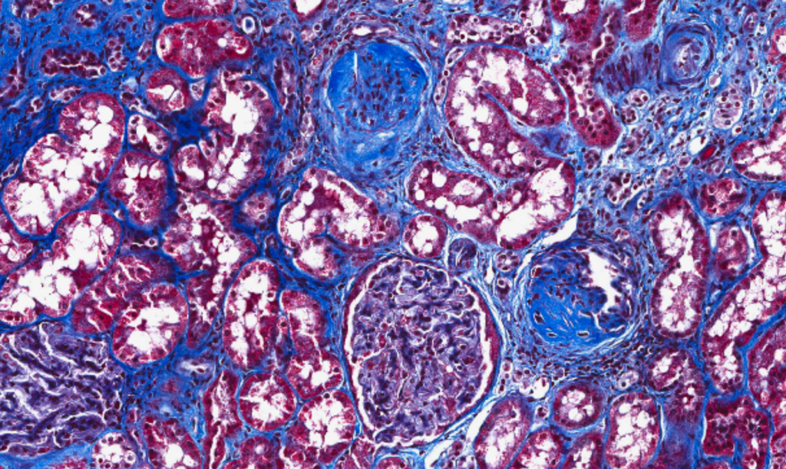
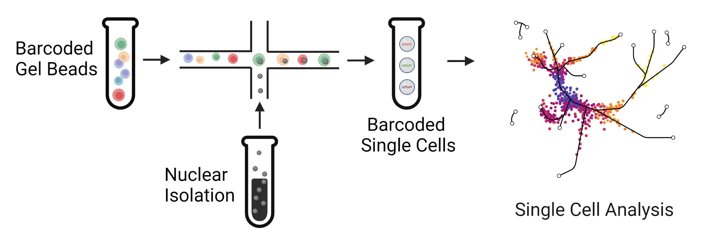
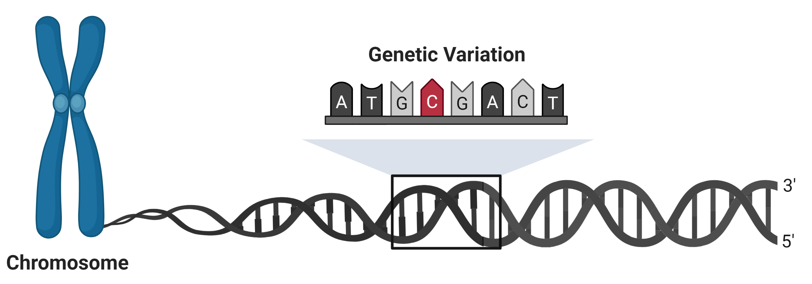
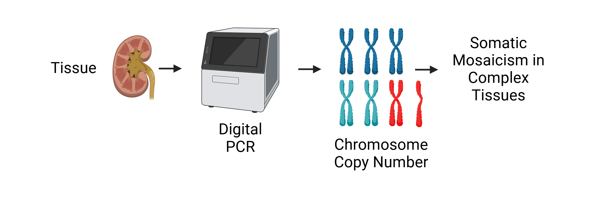
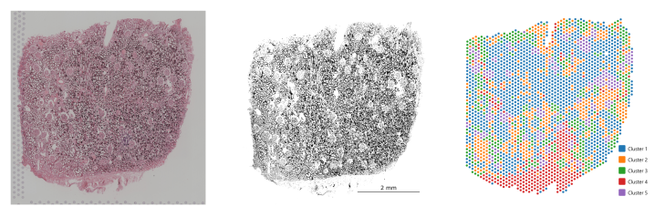
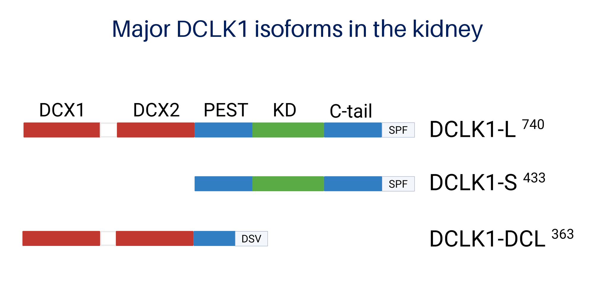
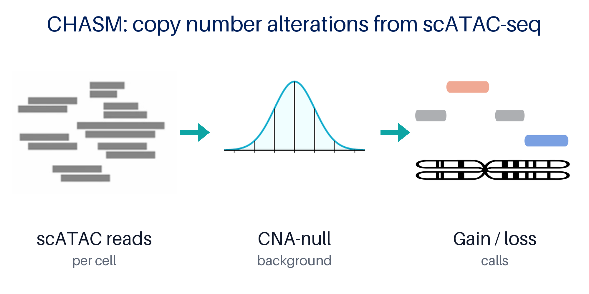






  
The Wilson Lab is part of the <strong>Division of Diagnostic Innovation</strong> in the Department of Pathology and Laboratory Medicine at the Perelman School of Medicine, University of Pennsylvania. We are also affiliated with the <strong>Penn/CHOP Kidney Innovation Center</strong> and the <strong>Institute for Diabetes, Obesity and Metabolism</strong>. The lab opened in January 2023 on the 7th floor of the Stellar-Chance Laboratories.

  
Chronic kidney disease (CKD) affects more than one in seven adults, and diabetes is its leading cause. Kidney biopsies show scarring, but they cannot tell us which cells started the damage or why some patients progress while others don't. We combine <strong>single-cell and spatial multiomics</strong>, <strong>human genetics</strong>, <strong>somatic mosaicism</strong> and <strong>computational methods</strong> to find the cell states that drive progression, then test those states as therapeutic targets in human cells and animal models.

  

{{ team | size }}

Team members

  

{{ n_pubs }}

Selected papers

  

{{ n_sw }}

Open-source tools

  

{{ n_talks }}

Talks

<h2 class="section-title">The big picture: injured proximal tubule cells</h2>

  

    
A thread running through our work is a population of <strong>injured proximal tubule cells</strong> (marked by VCAM1 and loss of HNF4A) that we first described with single-nucleus multiomics of the human kidney (<a href="/publications/PMID33850129/">Muto &amp; Wilson, <em>Nat Commun</em> 2021</a>). These cells are already present in healthy kidneys, and their number grows with aging and CKD. They take on a pro-inflammatory, pro-fibrotic state.

    
We have since shown that their open chromatin is enriched for the heritability of kidney function traits. They are also the cells most likely to carry somatic DNA damage, including loss of the Y chromosome and other chromosome gains and losses. They sit in fibrotic niches alongside fibroblasts and immune cells. Today we are asking what drives these cells into a damaged state, and whether we can push them back out.

  

  <figure class="about-row__img"><figcaption>Interstitial fibrosis in a kidney with CKD</figcaption></figure>

<h2 class="section-title">Research areas</h2>

<article class="card research-card">
  
  

    <h3 id="single-cell-multiomics">Single-cell multiomics of kidney disease</h3>
    
We profile gene expression and chromatin accessibility in thousands to millions of individual kidney cells. Our snRNA-seq and snATAC-seq atlases of early diabetic kidney disease found transcriptional changes in every nephron segment. They also implicated glucocorticoid and insulin receptor signaling in the diabetic proximal tubule, which we followed up with CUT&amp;RUN and CRISPRi of regulatory elements near <em>FKBP5</em>.

    
Wilson et al. <em>PNAS</em> 2019 · Muto &amp; Wilson <em>Nat Commun</em> 2021 · Wilson &amp; Muto <em>Nat Commun</em> 2022

  

</article>

<article class="card research-card">
  
  

    <h3 id="genetics-in-single-cells">Genetics in single cells</h3>
    
Why do some patients progress faster than others? We map germline variants to the cell types where they act, measure allele-specific expression and chromatin accessibility in single cells with our <a href="https://github.com/p4rkerw/SALSA">SALSA</a> workflow, and use partitioned heritability to link kidney GWAS signals to injured proximal tubule. With the Zhang lab, we built <strong>TraceBind</strong> for bias-corrected transcription factor footprinting in ATAC-seq.

    
Wilson &amp; Muto <em>Nat Commun</em> 2022 · Lin, Wang, Wilson &amp; Zhang <em>Nat Commun</em> 2026

  

</article>

<article class="card research-card">
  
  

    <h3 id="somatic-mosaicism">Somatic mosaicism and DNA damage</h3>
    
Kidney cells accumulate DNA damage with age. We showed that roughly 10–15% of cells in the male kidney have lost the Y chromosome, and that this loss is enriched in injured proximal tubule. To go further, we developed <strong>CHASM</strong> to detect chromosome-scale copy number alterations from scATAC-seq, <strong>digital PCR assays</strong> to validate them in tissue, and DEFND-seq-based approaches to sample the whole genome in single cells. Injured proximal tubule accumulates gains and losses on chromosomes 3, 7, 10 and X with age, a pattern that resembles renal cell carcinoma.

    
Wilson et al. <em>Genome Biol</em> 2024 · Chen, Wang et al. <em>bioRxiv</em> 2026

  

</article>

<article class="card research-card">
  
  

    <h3 id="spatial-profiling">Spatial profiling</h3>
    
Disease doesn't hit every part of the kidney equally. We use sequencing-based (Visium) and imaging-based (Xenium) spatial transcriptomics to locate injured cells and to map the fibrotic, pro-inflammatory microenvironments where injured proximal tubule, fibroblasts and macrophages meet. We also use these data to predict the intercellular signals that keep injury going. As renal pathologists, we pair this with histology and digital pathology, including stain normalization for whole-slide images.

    
Agraz et al. <em>IEEE OJEMB</em> 2024 · Verma &amp; Wilson <em>Am J Pathol</em> 2025

  

</article>

<article class="card research-card">
  
  

    <h3 id="dclk1">DCLK1 as a therapeutic target</h3>
    
The oncogene <strong>DCLK1</strong> (doublecortin-like kinase 1) is switched on in injured proximal tubule. Its expression increases with age and in models of CKD, and it has been linked to diabetic kidney disease by genome-wide meta-analysis. The kidney expresses several DCLK1 isoforms, not all of which have a kinase domain. We are studying how each isoform rewires signaling and protein interactions at the cell membrane, and testing small-molecule and peptide strategies to target DCLK1 in CKD and polycystic kidney disease.

    
Talks: <a href="/posts/2026/09/kumc-grantham-2026/">KUMC 2026</a> · <a href="/posts/2026/10/penn-odc-rare-disease-2026/">Penn ODC 2026</a>

  

</article>

<article class="card research-card">
  
  

    <h3 id="computational-methods">Computational methods and AI</h3>
    
We build and share open, reproducible software, from containerized single-cell pipelines to new methods:

    <ul>
      <li><a href="https://github.com/EmiliaCXY/CHASM">CHASM</a> detects chromosomal mosaicism in single cells.</li>
      <li><a href="https://github.com/yongqih/P3Bind">P3Bind</a> predicts PDZ–PBM binding affinity and designs peptides.</li>
      <li>We also study how well "virtual cell" models generalize to unseen perturbations.</li>
    </ul>
    
<a href="/software/">All software</a> · Huang, Wang &amp; Wilson <em>bioRxiv</em> 2026

  

</article>

<h2 class="section-title">Models and resources</h2>

<ul class="pill-list">
  <li>Human kidney single-cell, multiome and spatial cohorts</li>
  <li>Kidney Precision Medicine Project (KPMP) data</li>
  <li>Aging rat kidney</li>
  <li>Adenine-induced CKD</li>
  <li>Cisplatin-induced AKI</li>
  <li>Renal irradiation models</li>
  <li>CRISPR-engineered human renal epithelial cells</li>
  <li>QuantStudio Absolute Q digital PCR</li>
  <li>10x Multiome, Visium and Xenium</li>
</ul>

<h2 class="section-title">Funding</h2>

Our research is supported by the National Institute of Diabetes and Digestive and Kidney Diseases (NIDDK). Award details are on <a href="https://reporter.nih.gov/search/results?query=Parker%20Wilson">NIH RePORTER</a>.



<h3 class="grant-heading">Active</h3>


  <a class="card grant-card" href="{{ g.url }}">
    {{ g.mechanism }}
    
      {{ g.title }}
      {{ g.number }} · {{ g.sponsor }} · {{ g.years }}
      {{ g.role }}
    
  </a>


<h3 class="grant-heading">Completed</h3>


  <a class="card grant-card grant-card--done" href="{{ g.url }}">
    {{ g.mechanism }}
    
      {{ g.title }}
      {{ g.number }} · {{ g.sponsor }} · {{ g.years }}
      {{ g.role }}
    
  </a>


<h3 class="grant-heading">Other support and recognition</h3>


<i class="fas {{ x.icon }}"></i>
<strong>{{ x.name }}</strong> {{ x.detail }}



<i class="fas {{ x.icon }}"></i>
<strong>{{ x.name }}</strong> {{ x.detail }}



<h2 class="section-title">Collaborators</h2>

We work closely with the <a href="https://nzhanglab.github.io/">Nancy Zhang lab</a> (Wharton Statistics and Data Science) on statistical methods for single-cell genomics, and with the Humphreys lab (Washington University in St. Louis), where much of our early single-cell work began. We also collaborate with the Penn/CHOP Kidney Innovation Center, the Penn Institute for Regenerative Medicine, and the KUMC Jared Grantham Kidney Institute on polycystic kidney disease models.

<h2 class="section-title">About Dr. Wilson</h2>

  <figure class="about-row__img about-row__img--pi"></figure>
  

    
<strong>Parker C. Wilson, MD, PhD</strong> is an Assistant Professor of Pathology and Laboratory Medicine and a renal and molecular pathologist who provides histologic and genetic diagnoses for patients with kidney disease. He also directs Core C (tissue processing and pathology) of the NIDDK Human Pancreas Analysis Programs for type 1 and type 2 diabetes (HPAP-T1D and HPAP-T2D).

    <ul>
      <li>He studied Biomedical Engineering with a concentration in Computer Science at Johns Hopkins University.</li>
      <li>He earned his MD and PhD in Molecular and Cellular Biology and Pathobiology through the Medical Scientist Training Program at the Medical University of South Carolina.</li>
      <li>He completed residency in Anatomic and Clinical Pathology and a fellowship in Renal and Genitourinary Pathology at Yale.</li>
      <li>He did a second fellowship in Molecular Genetic Pathology at Washington University in St. Louis, where he joined the faculty and began single-cell studies of diabetic kidney disease with Benjamin Humphreys.</li>
    </ul>
    
He moved to Penn in 2023. Dr. Wilson speaks regularly about kidney omics and somatic mosaicism, at venues including ASN Kidney Week, the ADA Scientific Sessions, the APS Kidney Camp, and grand rounds at Penn, Johns Hopkins and Washington University.

    
<a class="btn btn--primary" href="/talks/">See all talks</a> <a class="btn btn--primary" href="/people/">Meet the team</a>

  

