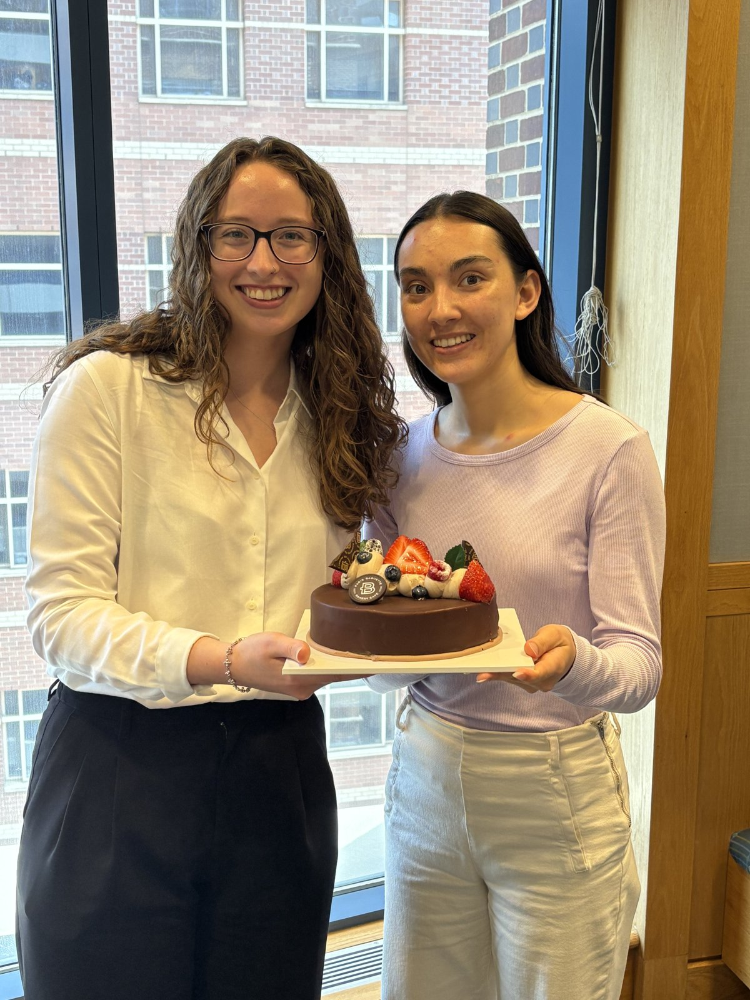

We said goodbye (with cake!) to Mia Pierce, who spent the summer in the Wilson lab through the Pathology Undergraduate Research Mentorship (PURM) program. Mia used digital PCR to measure mitochondrial DNA copy number in animal models of kidney disease. Thank you, Mia, and good luck back at Kalamazoo College!

{: .post-photo}
