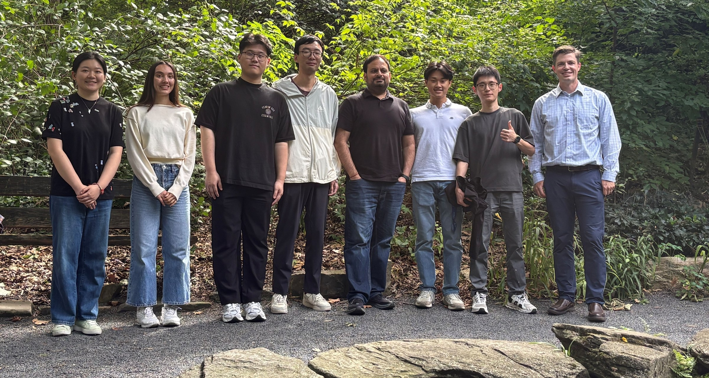

  
<h2>Our research</h2><a href="/about/">About the lab &rarr;</a>



  
<h2>Latest news</h2><a href="/year-archive/#news">All news &rarr;</a>

  

  
  
    <article class="card news-card">
      
<time>{{ post.date | date: "%b %-d, %Y" }}</time>News

      <h3 class="timeline__title"><a href="{{ post.url | relative_url }}">{{ post.title }}</a></h3>
      
{{ post.excerpt | markdownify | strip_html | truncate: 140 }}

    </article>
  
  

  
<h2>Recent talks</h2><a href="/talks/">All talks &rarr;</a>

  

  
    <article class="card news-card">
      
<time>{{ post.date | date: "%b %Y" }}</time>Talk

      <h3 class="timeline__title"><a href="{{ post.url | relative_url }}">{{ post.talk_title }}</a></h3>
      
<i class="fas fa-map-marker-alt"></i> {{ post.venue }}

    </article>
  
  

  <figure class="lab-photo">
    
    <figcaption>The Wilson Lab, 2026 &middot; <a href="/people/">Meet the team</a></figcaption>
  </figure>

  

    <h2>Join the lab!</h2>
    
We're always looking for talented researchers and collaborators. Send us an email or find us on social media.

  

  <a class="btn btn--large" href="mailto:parker.wilson@pennmedicine.upenn.edu">Get in touch</a>

